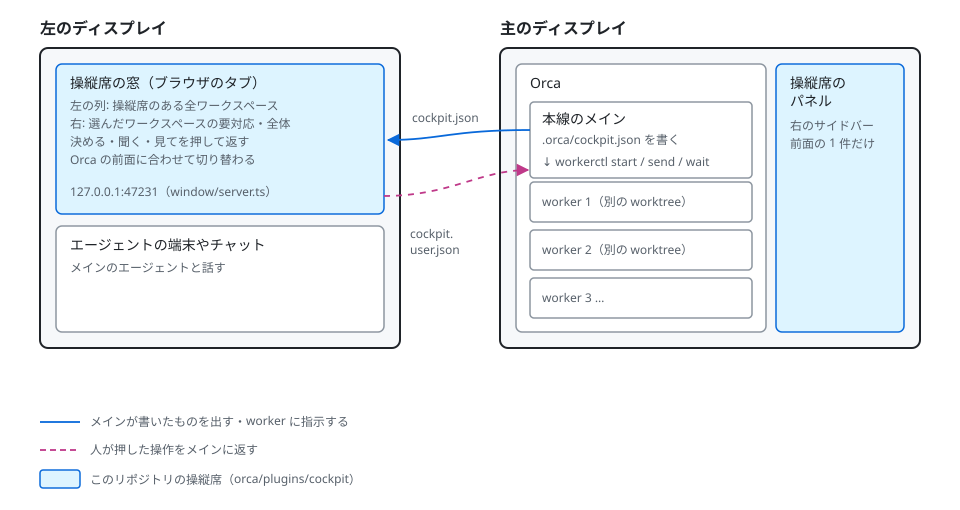

# agent-harness

Orca で複数のコーディングエージェントを並べて動かすときに、人が判断にだけ頭を使えるようにする道具の集まりです。案件ごとの窓口のエージェント（各ワークスペースのメイン）が作業を進め、人は「自分の番」のものだけを 1 か所で片付けます。

## 目指すもの

土台にある考えは一つです。持ち主の認知負荷は最も貴重な資源なので、人は判断と大事な確認にだけ頭を使い、抜けの検出・文脈の維持・情報の整理は、人が覚えていなくても仕組みが受け持ちます。そのために、窓口・担当・worker・Botのすべてが次の5つを守ります。

### 1. 漏れなく一貫して遂行する

窓口・担当・worker・Botは同じ構造と同じ名前の付け方で動き、受けた依頼を、済んだ証拠がそろうまで手放しません。抜けを人が覚えていることを前提にしないためです。

- 依頼は受けた時点で帳簿に載せ、済の条件と証拠（mainに入ったcommit、公開したページ、人の操作）で済を決める
- 抜けたら直すだけでなく、抜けた原因まで潰す
- 案件・仕事・タスク・workerは、名前と並びで階層が分かるようにする
- 決まりは領域ごとに1か所にだけ置き、ほかの文書はそこを指す。名前の形・工程名・必須の欄のように形で決まるものは、書く道具が入口で断る

### 2. 必要な情報を渡す

人に何かを頼むときは、判断に要る文脈・実物・具体例を最初からそろえます。聞き返しが1往復増えるたびに、人の時間と集中が削られるためです。

- 判断の依頼には、何を決めるか・今どうなっているか・選ぶと何が起きるか・得るもの・失うもの・おすすめを付ける
- 見てほしいページは手元のパスではなくURLで渡し、手作業はそのまま写せる手順で渡す
- 何を出すかは、これまでの指示と好みから割り出す。細部は、人が質問して取りに行ける形にしておく

### 3. 判断と協調を分類して回す

エージェントが決められることはエージェントが決め、理由と戻し方を報告で共有します。人に回すのは、外に出るもの・戻せないもの・要件や設計が変わるものだけです。全部を聞けば判断の数が依頼の数だけ増え、黙って決めれば信頼が崩れるためです。

- 人に回すものは、停止・許可・判断・送信前・確認の5種類に分け、期限順の1列に並べる
- 繰り返す許可は「この案件では任せる」で一任に切り替え、以後は聞かない
- 仕事は「任せる」「一緒に作る」「見張る」の3つの形に分け、形ごとに人の関わり方を変える
- 1つのBotは1つの案件を受け持ち、知らせる先も1つにする

### 4. 認知負荷を上げない

画面と文には、見る情報だけを決まった形で出します。説明文に頼らず、並び・位置・語で分からせます。

- 状態と種類は語で示し、意味の分からない印や色を増やさない
- エージェントの内部の作業と、窓口が自分で片付けるものは、人の前に出さない
- 報告・カード・画面の文は業務の漢語で書き、話し言葉や幼い言い回しを避ける
- 画面は、作ったモデルとは別系統のモデルに見た目を確認させてから出す

### 5. 文脈を管理してAIを鈍らせない

決定・制約・人の原文は会話の外に置き、圧縮しても原文のまま戻します。各エージェントには、その仕事に要る文脈だけを持たせます。文脈の質が、そのまま遂行の質になるためです。

- 決めたことは判断の記録に1行で残し、圧縮のあとに原文で流し直して、作業に戻る前に照合する
- 窓口は人と話すために空けておき、調査はsubagent、コードはworker、1日を超える仕事は担当に出す
- 写した会話で決まったことは本線に返し、記録と帳簿に書いてから作業に反映する
- 閉じた話や関係のない話で、本線の文脈を汚さない

### 作り方の約束

- 根本から直し、場当たりの継ぎはぎにしない。ただし検査・スクリプト・定期確認をむやみに増やさない。まず写しを消し、今ある仕組みを使い回す
- 状態は1か所に持ち、どの画面から見ても同じに出す
- 早く出して、使いながら直す
- 費用・規約・外に出るものは、歯止めを先に決める
- 設計とコードのレビュー、日本語と見た目の確認には、作ったモデルとは別系統のモデルの目を通す

| 道具 | できること |
|---|---|
| 操縦席（`orca/plugins/cockpit`） | 全案件で自分の番のもの（判断・許可・送信前など）を、期限順の1列に並べる画面。押した操作は窓口に届き、迷うものは仕事の担当のチャットへ渡せる |
| orca-launch（`bin/orca-launch`） | worker（別の worktree の端末で動く Claude Code や Codex）を、Orca で今選ばれている Claude の席と worker 用の設定で立ち上げ、指示を Orca の orchestration の Task として渡す |
| stallwatch（`bin/stallwatch`） | Orca の監視外で止まったもの（Orca そのもの・各ワークスペースのメイン・操縦席の窓・launchd の定時ジョブ）を数分おきに見て、macOS の通知と操縦席の窓の上の帯に出す。モデルは呼ばない |
| worktree-sweep（`bin/worktree-sweep`） | 取り込み済みで使い終わった worker・担当の worktree を毎晩消し、取り込むか捨てるかを人が決めるものを一覧にする。モデルは呼ばない |
| account-failover（`bin/account-failover`） | 今の Claude の席が利用枠の上限に当たったら、優先度が高く空いている席へ切り替え、Orca が起動し直した端末に続きを頼む。全部の席が上限なら戻る時刻を知らせる。モデルは呼ばない |

## 毎日の使い方



左のディスプレイに操縦席の窓を置き、主のディスプレイに Orca を置きます。

1. 朝は窓の上の帯で全案件の「私の番」の数を見て、1列を上から片付けます。判断のカードはおすすめを選んだ状態で開くので、よければボタンを1回押すだけで次のカードに進みます
2. 迷うカードは「担当と話す」を押します。カードの書き出しがクリップボードに入り、Orca でその仕事の担当のいるワークスペースが前に出るので、知らせに出たタブを開いて貼ります。決まったことは担当がカードに書き戻します
3. SlackやTeamsの連絡は、見張りのBot（このリポジトリの外）が拾って「受信」に出し、返事が要るものは担当が「送信前」の文面にします。人はコピーして送り、「送信済みにする」を押します
4. workerの結果は「確認」に出ます。止まったworkerは、窓口が書かなくても1列の先頭の「停止」に出ます
5. 一緒に作る仕事は、返事待ちでなくても1列に「共同作業」として常に出て、そこから担当のチャットに移れます。仕事の形の細部はnix-darwinのcockpit skillの「仕事の形」にあります
6. 夕方は要対応のタブの下の「報告（参照のみ）」、全体のタブの「顧客待ち」の仕事、対応済みのタブ（直近14日）を見て、残りを確かめます

画面の見方、カードの種類、キーボードの操作は [操縦席の README](orca/plugins/cockpit/README.md) にあります。

## 入れ方

macOS、Orca 1.4.259 以降、Node 24 以降、Python 3.9 以降を前提とします。

1. 置き場所に clone する。以下の例は `~/.config/agent-harness`
   ```sh
   git clone https://github.com/<owner>/agent-harness ~/.config/agent-harness
   ```
2. `orca-launch` を PATH に通し、worker に付ける Claude Code 設定のパスを `ORCA_WORKER_SETTINGS` に入れる（無ければ設定を付けずに起動する）
   ```sh
   ln -s ~/.config/agent-harness/bin/orca-launch ~/.local/bin/orca-launch
   export ORCA_WORKER_SETTINGS=~/.claude/settings.worker.json
   ```
3. 操縦席のプラグインをフォルダから入れる。権限の確認が出たら、表示された `--approve <fingerprint>` を付けて打ち直す
   ```sh
   orca plugin install ~/.config/agent-harness/orca/plugins/cockpit
   ```
4. 窓の常駐プロセスを launchd で動かす。`~/Library/LaunchAgents/` に置く plist の主な項目は次のとおり。窓はブラウザで `http://127.0.0.1:47231` を開いて表示する
   ```xml
   <key>ProgramArguments</key>
   <array>
     <string>/path/to/node</string>
     <string>--disable-warning=ExperimentalWarning</string>
     <string>/Users/you/.config/agent-harness/orca/plugins/cockpit/window/server.ts</string>
   </array>
   <key>EnvironmentVariables</key>
   <dict>
     <!-- orca CLI を呼ぶので Orca.app の bin を入れる -->
     <key>PATH</key><string>/Applications/Orca.app/Contents/Resources/bin:/usr/bin:/bin</string>
   </dict>
   <key>RunAtLoad</key><true/>
   <key>KeepAlive</key><true/>
   ```
5. 見張り（stallwatch）を launchd で 5 分おきに動かす。Orca の更新や再起動でメインと一緒に止まらないよう、Orca の automations ではなく launchd に置く。PATH には orca CLI のある Orca.app の bin を入れる
   ```xml
   <key>ProgramArguments</key>
   <array>
     <string>/usr/bin/python3</string>
     <string>/Users/you/.config/agent-harness/bin/stallwatch</string>
     <string>--window-log</string><string>/Users/you/Library/Logs/cockpit-window.log</string>
     <string>--service</string><string>com.example.cockpit-window</string>
     <string>--job</string><string>com.example.nightly=/Users/you/Library/Logs/nightly.log</string>
   </array>
   <key>StartInterval</key><integer>300</integer>
   ```
   `--job` は終了コードとログの最後の行を見る（失敗した実行のあとでも launchctl が終了コード 0 を返したことがあるので、ログにだけ残った失敗も拾う）。`--service` は動いているかを見る。知らせは macOS の通知と窓の上の帯だけに出し、会話の中へは送らない（worker の完了と停止でメインを起こすのは Orca の orchestration。launchd から `orca orchestration send` を打つと送り主が決まらず断られる）

6. worktree の見回り（worktree-sweep）を launchd で毎晩 1 回 `--apply` 付きで動かす。PATH には orca CLI のある Orca.app の bin と git と gh を入れる。何を消すかは下の「worktree の片付け」にある
   ```xml
   <key>ProgramArguments</key>
   <array>
     <string>/usr/bin/python3</string>
     <string>/Users/you/.config/agent-harness/bin/worktree-sweep</string>
     <string>--apply</string>
   </array>
   <key>StartCalendarInterval</key><dict><key>Hour</key><integer>23</integer><key>Minute</key><integer>30</integer></dict>
   <key>EnvironmentVariables</key>
   <dict>
     <key>PATH</key><string>/Applications/Orca.app/Contents/Resources/bin:/usr/bin:/bin</string>
   </dict>
   ```
   stallwatch の `--job <label>=<ログ>` に足しておくと、消せなかった回や Orca の一覧を読めなかった回（終了コード 1）が通知と窓の帯に出る

7. 席の切り替え（account-failover）を launchd で 1 分おきに動かす。`--seat` に切り替えてよい席のメールアドレスを優先度の高い順に並べる（Orca の `orca account list` に出る席だけ）。PATH には orca CLI のある Orca.app の bin を入れる。何をするかは下の「利用枠の上限で席を切り替える」にある
   ```xml
   <key>ProgramArguments</key>
   <array>
     <string>/usr/bin/python3</string>
     <string>/Users/you/.config/agent-harness/bin/account-failover</string>
     <string>--seat</string><string>me@example.com</string>
     <string>--seat</string><string>second@example.com</string>
   </array>
   <key>StartInterval</key><integer>60</integer>
   <key>EnvironmentVariables</key>
   <dict>
     <key>PATH</key><string>/Applications/Orca.app/Contents/Resources/bin:/usr/bin:/bin</string>
   </dict>
   <key>StandardOutPath</key><string>/Users/you/Library/Logs/account-failover.log</string>
   <key>StandardErrorPath</key><string>/Users/you/Library/Logs/account-failover.log</string>
   ```
   入れる前に `--dry-run`（`--assume-full` を足すと今の席を上限と見なす）で、どの席へ移り、どの端末に続きを頼むかを確かめる。stallwatch の `--job` に足すと、失敗した回が窓の帯に出る

8. Orca本体の見張り（orca-watch）をlaunchdの `KeepAlive` で常駐させる。PATHにはorca CLIのある Orca.app のbinと、`ioreg` のある `/usr/sbin` を入れる。何をするかは下の「Orca本体が落ちたら起動し直す」にある
   ```xml
   <key>ProgramArguments</key>
   <array>
     <string>/usr/bin/python3</string>
     <string>/Users/you/.config/agent-harness/bin/orca-watch</string>
   </array>
   <key>RunAtLoad</key><true/>
   <key>KeepAlive</key><true/>
   <key>EnvironmentVariables</key>
   <dict>
     <key>PATH</key><string>/Applications/Orca.app/Contents/Resources/bin:/usr/sbin:/usr/bin:/bin</string>
   </dict>
   <key>StandardOutPath</key><string>/Users/you/Library/Logs/orca-watch.log</string>
   <key>StandardErrorPath</key><string>/Users/you/Library/Logs/orca-watch.log</string>
   ```
   stallwatchの `--service` に足しておくと、見張りが動いていないときに通知と窓の帯に出る

窓口のエージェントには、`.orca/cockpit.json` にカードを書かせます。ファイルの形と最小の例は [操縦席の README の「ファイルの形」](orca/plugins/cockpit/README.md#ファイルの形バージョン-2) にあります。

<details>
<summary>設定のリポジトリ（nix-darwin）から参照するとき</summary>

作者は nix-darwin（home-manager）の設定から、このリポジトリの clone を `mkOutOfStoreSymlink` で指しています。手で直した内容を switch なしですぐ使えるようにすることを優先し、次の 2 点から flake input にはしませんでした。

- flake input にすると、ファイルが読み取り専用の `/nix/store` に入る。1 行直して確かめるたびに、commit・push・`nix flake update`・switch が要る
- Orca は操縦席をフォルダから入れ、launchd は `server.ts` をそのまま動かす。どちらも書き換えられる実体のパスを指す必要がある

代わりに、home-manager の activation で clone が無いときだけ clone します。どのコミットで動いているかは clone の `git log` で分かりますが、flake.lock のようには固定されません。

```nix
home.activation.agentHarness = lib.hm.dag.entryAfter [ "writeBoundary" ] ''
  if [ ! -e "$HOME/.config/agent-harness" ] && [[ ! -v DRY_RUN ]]; then
    ${pkgs.git}/bin/git clone https://github.com/<owner>/agent-harness "$HOME/.config/agent-harness" || true
  fi
'';
home.file.".local/bin/orca-launch".source =
  config.lib.file.mkOutOfStoreSymlink "${config.home.homeDirectory}/.config/agent-harness/bin/orca-launch";
```

</details>

## worktree の片付け

worker の結果を取り込んだら、窓口がその場で worktree を消します（worktree-flow skill の決まり）。worktree-sweep は、そこで取りこぼしたものを拾う 2 段階目です。Orca は終わった worker の端末を閉じますが、worktree は消しません。

見るのは、Orca が `~/orca/workspaces/<リポジトリ>/<名前>`（`--under` で変えられる）に作った worktree だけです。リポジトリのルートと、Orca 以外で作った checkout は見ません。1 つずつ次の 3 つに分けます。

| 分け方 | 条件 | `--apply` のとき |
|---|---|---|
| 触らない | 作業中のエージェントがいる、Orca の状態が `completed`、担当か worker の dispatch が生きている（`orca orchestration worker-list` で Task が終わっていないか端末が live）、開発用プラグインの読み込み元、エージェントの会話が開いている（担当のチャットや人の会話。入力待ちのまま 24 時間たっても人に決めさせる対象に出さない）、残っているものがあっても動きが無くなって 24 時間たっていない | 何もしない |
| 判断が要る | 動きが無いまま 24 時間以上で、次のどれかがある: その worktree を使った worker・担当が終わった記録（worker-list の終わった dispatch）が無い、未 commit・未追跡のファイル（ルートから写した `CLAUDE.local.md` なども含む）、default ブランチに無い commit・マージコミット、detached HEAD、ルートと違うかルートに無い gitignore されたファイル（`.env` など）、作り直せると決めていない gitignore されたディレクトリ（`postgres_data/` など）。同じリポジトリで同じブランチかパスの worktree が 2 つ以上ある（Orca の一覧の外のものも `git worktree list` で数える）、Orca の記録と実際のブランチが違う、git の検査が通らない場合もここ | 何もしない。取り込むか捨てるかを人が決める |
| 消してよい | 上のどれにも当たらず、作られて 24 時間以上たっている（その worktree を使った worker・担当が終わった記録があり、取り込み済みで、固有のデータが無い。または、ブランチの PR がマージ済みで、そのあとに commit を積んでおらず、固有のデータが無い） | `orca worktree rm --worktree path:<path> --delete-branch` で消す |

- worktree を残したいときは、Orca で状態を `completed` にする（`orca worktree set --worktree path:<path> --workspace-status completed`）。`comment` は担当や操縦席が書き換えるので、残す印には使わない
- default ブランチは、リポジトリごとに `origin/HEAD` から決める。ローカルの default と `origin` の default のどちらか一方に全部入っていれば入っている扱いにする（2 つに分かれて入っているものは入っていない扱い）。squash merge で入れたブランチは `git cherry` で入っていないと出るので、ブランチの PR を `gh pr list --state merged --head <branch>`（worktree の remote のリポジトリ）で見る。マージ済みの PR の head の SHA が今の HEAD と同じなら、default に入っていない commit があっても、終わった記録が無くても（担当の居場所・手で立てた worktree）消してよい扱いにする。HEAD が違えば（マージのあとに積んだ commit がある）「判断が要る」に回す。未 commit のファイル・固有のデータ・作業中のエージェント・開いている会話・生きている dispatch があるものは、PR がマージ済みでも消さない。gh を読めなければ、その理由を添えて今までどおり扱う。launchd の PATH に gh（`/run/current-system/sw/bin`）を入れる
- 人が Orca で作ったばかりの worktree は、worker・担当が終わった記録が無いので消さない（24 時間たつと「判断が要る」に出る）。終わった記録はパスで当てるので、片付けたあとに同じパスで作り直した worktree にも当たる。Orca は dispatch の時刻を launchd から読める形で出さないので、作られて（ps の `createdAt`）24 時間たつまでは消さない
- 終わった記録として数えるのは、state が終わっていて liveness が `exited` か `unverifiable` の dispatch だけ。liveness が欠けている・知らない値のものは生きているものとして守る
- 未追跡のファイルは、ルートから写した `CLAUDE.local.md`・`.claude/settings.local.json` でも残す理由にする（確かめた後に人が保存しうるので、無人では消さない）。この 2 つは gitignore されていてルートと同じ中身でも残す理由にする。消すときは `--force` を付けずに `orca worktree rm` を呼ぶ（読み直した後に何か書かれていれば git が断る）
- gitignore されたディレクトリは、作り直せると決めた名前（`node_modules`・`.venv`・`venv`・`dist`・`build`・`.next`・`.nuxt`・`.output`・`__pycache__`・`.turbo`・`.cache`・`.pytest_cache`・`.mypy_cache`・`.ruff_cache`・`.parcel-cache`・`.svelte-kit`・`coverage`・`.tox`・`.gradle`）と、中身が `*` だけの `.gitignore` を置いた道具の置き場（`.pytest_cache`・`.husky/_` など）の下だけを見ない。それ以外（ローカルの DB の `postgres_data/` など）は中身を見ずに残す理由にする。作り直せるものを足すときは `bin/worktree-sweep` の `REGEN` に足す
- gitignore されたファイルは、上の置き場の下と `.DS_Store` を除いて、ルートと同じ中身でなければ残す理由にする
- パスはシンボリックリンクを解いた実体で比べる
- `--apply` では、消す直前にその 1 件を Orca から読み直し、まだ「消してよい」のときだけ消す
- dispatch の一覧かプラグインの一覧を読めなかった回は、何も消さない。応答に `workers`・`plugins` の配列が無い、開発用プラグインの読み込み元が空のときも読めなかった扱い
- 結果は 1 行ずつ出し、最後の行に件数を出す。消せなかったものがあったか、dispatch かプラグインの一覧を読めなかったときは終了コード 1
- 同じ結果を `~/Library/Application Support/worktree-sweep/sweep.json`（`WORKTREE_SWEEP_HOME`）にも書く。`decide` が判断が要るもので、各項目の `parent` は親の worktree のパス、`main` は親を辿って最初に当たる窓口のワークスペースのパス（担当の下の worker も窓口に届く）。メインの hook は `main` で自分の下だけを拾える

## Orca本体が落ちたら起動し直す

2026-11-21・22の夜、macOSの自動アップデートの再起動がOrca本体を正常に終了させ、Chromeが終了を断って再起動が中止されたため、Orcaは朝まで止まっていた。Orcaのdaemonとclaudeは動き続けていたので、Orcaを起動し直せば作業は戻る。同じときlaunchdのユーザーの領域が on-demand-only になり、一定間隔のジョブ（stallwatch・account-failover）は起こされなかった。そこで、すでに動いている常駐のプロセス（orca-watch）が1分おきに `orca status` の `runtime.reachable` を見る。

- 落ちたのに気づいたら、1回だけ起動し直してよい落ち方かを決める。Orcaが最後に動いていたのを見た時刻より後にキーボードかマウスが触られていれば（`ioreg` の `HIDIdleTime`）、人が自分で終了したと見なして起動し直さない。見張りが動き出してからOrcaを一度も見ていないときと、無操作の時間を読めないときも起動し直さない
- この見分け方は入力の有無しか見ないので、両方向に外れる。人がいる間にOrcaが落ちて、そのあと別のアプリを触ると起動し直さない（人がいるので気づける）。人が触らずにOrcaを終える手段（別の端末からの終了など）では起動し直す。確実に止めておきたいときは `~/Library/Application Support/stallwatch/orca-watch.pause`（`STALLWATCH_HOME`）を置く。起動し直す直前にも見る
- 人のいないあいだに落ちていれば、気づいてから5分待って `open -a Orca` を打つ（macOSの再起動の手順は2026-11-22で47秒だった。Orcaの自己更新にかかる時間は測っていない。5分を超える手順の途中には打ちうる）。戻らなければ5分おきに試し、1時間に3回で止めて通知する。止めたあとは、最後に起動し直してから1時間たって、Orcaが動いているのを見るまで起動し直さない
- `orca status` が失敗し続けるだけでOrca本体は動いているときも、止まっていると数える。`open -a Orca` は動いているOrcaを前に出すだけなので、3回で止まって通知する
- 起動し直す前に回数を記録に書く。書けなければ起動しない（回数を残さないまま起動し続けないため）
- `open -a Orca` を打ったこと・失敗したこと・止めたことは `~/Library/Logs/orca-watch.log` に書き、`STALLWATCH_HOME/orca-watch.json` に書いたものをstallwatchが窓の帯に合流させる。「見張りが起動し直した」は、Orcaが戻ったのを見てから12時間出す。stallwatchが起こされない間は帯に出ず、ログにだけ残る
- 見張り自身の例外ではプロセスを終えない（on-demand-only の間はlaunchdが起こし直さないため）。同じ例外はログに1回だけ書く

## 利用枠の上限で席を切り替える

account-failover は、Orca が読んでいる各席の使用量（`orca account list --json` の `rateLimits`。ほかの席の分も、その席を使わずに Orca が読んでいる）だけで判断し、トークンや Keychain には触りません。

1. 今の席の 5 時間の枠か週の枠が 100% で、戻る時刻がまだ先なら「上限」と見なす。Orca の読みが 30 分より古いか読めていないときは判断しない。Fable の週の枠は見ない
2. 行き先は `--seat` の優先度順に選ぶ。使用量が空きと分かっている席を先に、無ければ使用量の分からない席を試す。Orca の `stale-token`（しばらく動いていない席のトークンが古いだけで、次に Claude が動けば更新される）は使用量の分からない席として試す。上限で離れた席は、その枠が戻る時刻を過ぎるか、離れたあとに Orca が空きと読むまで選ばない
3. 次の席は行き先にしない。上限でないあいだも窓の帯に「上限に当たってもこの席へは切り替えない」と出し、行き先が無くなったら切り替えずに通知と帯で名指しする
   - ログインが切れている席（Orca の使用量の失敗が `missing-credentials`）。Orca のアカウントの画面でログインし直す
   - claude を対話で起こすと、席で一度だけの確認の画面で止まる席（その席の `.claude.json` で、初回の設定が済んでいないか、`settings.json` の `permissions.defaultMode` が auto 以外なのに「auto mode を既定にするか」に答えた記録 `hasSeenAutoDefaultNudge` が無い）。その席で一度 claude を対話で起こして答えると、記録が残って行き先に戻る
4. 切り替える前に、前景が Claude の端末をすべて控え、そのうち上限の 1 行が画面に出ている端末と作業中の端末に印を付ける。あわせて、worker の端末とその設定（`--settings` のファイル）を控える。worker かどうかは、切り替える前に in_progress の Dispatch があるかに加えて、orca-launch の記録（`STALLWATCH_HOME/worker-launches.json`。端末の handle → 設定のファイル・モデル）か、今の起動の行に設定のファイルを指す `--settings` があるかで見る（Task を終えて開いたまま待っている worker は Dispatch を持たないため）。Orca が claude に直に渡す JSON の `--settings`（`{"fastMode":false}` など）は worker の設定と見なさない
5. `orca account select` で切り替える。CLI からの切り替えを、Orca の窓は起動し直しとして扱い、古い席で前景に Claude がいる端末を `claude --resume` で開き直す（Orca の設定「確認する」なら確認を出し、「確認しない」なら黙って開き直す）。窓に出ていない端末は、tabId・leafId を `pty:<ptyId>` にして開き直し、元の枠を `recordedPaneKey` に残す（`orca agent list` の paneKey もこちら）ので、端末の枠は `recordedPaneKey` があればそれで、無ければ tabId・leafId で見る。Bash などの子プロセスが前景の端末は移らない
6. 控えた端末が起動し直す（最大 90 秒待つ）のを、同じ枠で ptyId が変わったかで見分ける。古い端末が消えて別の枠に開いたときは、同じ worktree で別の用事に起こした Claude と見分けられないので、起動し直した先とは見なさず「起動し直した先が分からない端末」として知らせる。ただし失った worker の端末は、切り替えのあとにその worktree で開いた Dispatch の無い Claude の端末が 1 つだけなら、Orca が別の枠に開き直したものと見なす（2026-11-22 12:22 の本物で、Orca は cockpit-v3 の worker を別の枠の term_88cf3315 に開き直した）。印を付けた端末が入力待ちになったら「席を切り替えて起動し直した。止まったところから続けて」と送る。ほかの端末は、確認の画面で止まっていないかだけを見る
7. Orca は起動し直すとき古い端末を閉じるので、そこで動いていた worker の Dispatch は lost（`operator_close`）になり、Task は ready に戻る。切り替えのあと、下の「切り替えたあとに worker を結び直す」の 1〜5 で確かめた worker は、launchd から Run の coordinator の名（`orca orchestration run-show --id <run> --full` の `coordinator_handle` を `--from` に渡す）で結び直す。Orca は送り主の決まらない orchestration のコマンドを `no_active_sender_terminal` で断るが、`--from` に coordinator の handle を渡すと受け付ける（2026-11-22 に存在しない Task で確かめた。coordinator が上限で止まっていても結び直せる）。結び直した worker には worker-start が Task を渡して作業を始めさせるので、続きは別に頼まず、worker の端末から coordinator に「結び直した。同じ Task を別の worker に出さない」と送る。知らせを送れなければ `STALLWATCH_HOME/failover-tells.json` に残し、次の回に送り直す。結び直せなければ、coordinator が別の端末に出し直した同じ Task と二重に動かないよう続きを頼まず、coordinator が `--after-switch` を打つよう知らせる。Orca が起こし直した claude は、orca-launch が付けた `--settings`（worker の設定。sandbox と送る道具の deny）を落とす（Orca の `--plugin-dir <orca-agent-view> --dangerously-skip-permissions --effort high --resume <会話 id>` だけで起きる）ので、失った worker の端末では、続きを頼む前に下の「worker の設定で起こし直す」をする。できなければ、sandbox の外で作業を続けさせないよう続きを頼まず、名指しして知らせる。Task を持たずに待っていた worker も、設定を付けて起こし直す（結び直すものは無い）。起こし直したら、orca-launch の記録を新しい端末に移す（次の切り替えでも戻せるように）
8. Orca が起動し直さなかった端末（元の席のまま残る）は、切り替えのときの会話 id（Orca の agent list で端末の claude は `claude_<会話 id>` で出る）・worker かどうか・worker の設定と合わせて `failover-state.json` の `stale` に控え、次の回から 1 分おきに見る。入力待ちになったら、同じ端末で `/exit` を送り、`env CLAUDE_CONFIG_DIR=<今の席> claude [--model … --settings …] --resume <会話 id>` と起こし直し、上限の 1 行が出ていた端末には続きを頼む
   - 切り替えのときと会話が替わっていれば（人が同じ端末で別の会話を始めた）、触らない
   - worker（Dispatch を受けたことがある端末か、worker の設定で動いていた端末）で設定が分からなければ、sandbox の外で動かさないよう触らない
   - Task を持つ worker は、元の席の上限で止まっているときだけ起こし直す（ほかは claude を終えると Dispatch を失うので待つ）。起こし直したあと Dispatch が生きていれば続きを頼み、閉じていれば Run の coordinator の名で同じ Task を同じ端末に結び直す
   - 作業中か確認の画面の端末は次の回に回す。claude を終えたあとで失敗したら、次の回は起こすところから続ける。3 回失敗するか 6 時間たったら諦めて知らせる
9. 切り替えたことを、チャット（窓口・担当）は起動し直らないことと合わせて、通知・窓の帯（30 分）・`~/Library/Application Support/stallwatch/failover-history.jsonl`（`STALLWATCH_HOME`）に、時刻・元の席・先の席・続けさせた端末・移らなかった端末・確認の画面で止まった端末・Dispatch を失った worker・上限で止まっているチャットとして残す

### 切り替えたあとに worker を結び直す（`account-failover --after-switch`）

自動の切り替えは、確かめられた worker を launchd から coordinator の名で結び直します（上の 7）。結び直せなかったものと、手で切り替えたあとは、coordinator（窓口・担当）が自分の端末やチャットから `account-failover --after-switch` を打ちます（自動の切り替えと同じロック（`STALLWATCH_HOME/failover.lock`）を待ってから打つ。`--dry-run` で何を結び直すかだけを出す。`--since-min` で見る範囲を変える。既定は 60 分）。

1. 直近に `operator_close` で失った worker の Dispatch を、worktree ごとに最後の 1 件だけ拾う
2. 失ったあとに同じ Task が別の Dispatch で動いた（`orca orchestration task-list --run <run>` で Task が別の Dispatch に dispatched か、worker の一覧に同じ Task の新しい Dispatch がある）なら、「結び直し済み（ctx_…）」と出して飛ばす。Task が completed なら「Task は終わっている」と出して飛ばす。Task の状態を読めなければ結び直さない
3. Orca が起こし直した端末を、次のどちらかで探す。どちらでもなく同じ worktree に Claude がいるときは、切り替える前からいた別の Claude と見分けられないので、候補と打つコマンドを出すだけにする（別の用事の Claude に Task を打ち込まない）
   - 同じ枠（上の `recordedPaneKey`）に開いた端末
   - 同じ worktree で、失った worker の会話を開き直した端末。失った会話 id は、Orca が閉じた端末の最後の画面（`worker-show --full` の terminal.preview）に Claude Code が出す「Resume this session with: … --resume <id>」から、開き直した会話 id は、Orca が新しい端末に打った `claude … --resume <id>` が残る出力の先頭（`orca terminal read --cursor 0`）から読む。出力の先頭がもう残っていなければ確かめられない扱い。同じ会話の端末が 1 つに決まるときだけ使う。Dispatch が動いている端末は入れない（2026-11-22 の本物で、coordinator が同じ会話を `orca-launch -- --resume <id>` で新しい worker に立て直していた）
4. その端末が入力待ちなら、同じ Task を結び直す。Orca は `operator_close` で失った Task を ready に戻し、`--retry-of` は failed・blocked の Task にしか受け付けない（ready の Task に付けると `task_not_startable`）ので、Task が failed・blocked のときだけ `--retry-of <失った Dispatch>` を付ける。確認の画面で止まっていれば打たない（指示の文字が画面の選択肢を選ぶため）。結び直す前に、下の「worker の設定で起こし直す」をする。できなければ結び直さず、打つコマンドを出す
5. 起こし直した端末に、失ったあとの別の Dispatch がある（担当が続き（followUpOf）を送った、誰かが結び直した。終わったものも含む）なら、「結び直し済み（ctx_…）」と出して飛ばす。同じ worktree で別の worker が今動いていれば、2 つが同じファイルを触らないよう結び直さない。Orca が起こし直したと確かめた端末（同じ枠・同じ会話・自動の切り替えでは別の枠に 1 つだけ開いたもの）が worker の設定なしで残っていれば、入力待ちのときに `orca terminal close` で閉じる（会話は Claude の会話記録に残る。2026-11-22 12:22 の本物では、coordinator が 26〜56 秒で worker を立て直し、launchd が調べた 12:24 には Orca の起こし直しが worker の設定なしで同じ worktree に残っていた）。確かめられない候補は閉じるか確かめるよう出す（残っていなければ立て直し済みとして黙る）。起こし直した端末が見つからなければ、orca-launch で立て直すよう出す
6. ほかの Run の Dispatch で断られたら、その Run の coordinator が打つコマンドを出す。詳細を読めなかった Dispatch は「確かめていない」と出す。あわせて、確認の画面で止まっている Claude の端末と上限で止まっているチャットを出す。結び直せないもの・確かめていないもの・止まった端末が残れば終了コード 1

worker の設定で起こし直す（`--after-switch` と自動の切り替えの両方）:

- 起こし直した claude の起動の行は、端末の出力（`orca terminal read --cursor 0`）で最後に claude を起こした行（Orca が打った行か、ここで打った `env … claude …` の行。Claude Code の終わりの案内の行は除く）を読む。出力は打った文字が崩れて積もり（2026-11-21 の本物で、手で打った `env … claude … --settings …` が `clenv '…` と残り、Orca が打った行も画面の幅で切れて `--resume` が残っていなかった）、プロセスの引数は worker の sandbox からは読めない（`ps` が operation not permitted）ので、次のように扱う
  - Orca が打った行（`orca-agent-view` を含む）は、`--resume` が見えなくても Orca が起こし直した claude と見なす。会話 id は終わりの案内から取る
  - 自動の切り替えでは、起動の行を読めないか会話 id が無いとき、新しい席の置き場所の `sessions/<pid>.json`（Claude Code が動いている claude ごとに書く。`sessionId`・`cwd`・`startedAt`・`entrypoint`）から、切り替えのあとにその worktree で起きた端末の claude（`entrypoint` が `cli`）の会話 id を取る。1 つに決まるときだけ使い、失った worker ならその会話 id と一致するときだけ使う。2026-11-22 12:22 の本物では、Orca の行が `'<会話 id>'o/Library/…/orca-agent-view' '--effort' 'medium' '--resume'` と崩れ、Task を終えて待っていた worker（max-win-notify-first）を設定なしのまま残した。`/exit` のあとの終わりの案内にその会話 id が出るのを待ってから起こし直すので、取り違えれば起こし直さずに止まる
  - `orca-agent-view` も `--resume` も無い行は新しい会話の claude と見なし、同じ枠でも当てない
  - 最後の起動の行のあとに claude が終わった跡（終わりの案内）があり、そのあとの起こし方を拾えなければ、誰かがもう起こし直したと見なして止め、確かめてから打つ結び直しのコマンドを出す。自動の切り替えが起こし直した端末と会話 id は `STALLWATCH_HOME/failover-state.json` の `relaunched` に残し、その組なら設定で動いていると見なして結び直す
- 失った worker の元の引数（`--model`・`--settings`）は、orca-launch の記録（切り替える前に起動の行から控えたものを含む）、Orca が閉じた端末の終わりの案内（`Resume this session with: … --settings … --resume <id>`）、`$ORCA_WORKER_SETTINGS` の順に読む（モデルの既定は opus）。2026-11-22 の本物では、終わりの案内に `--settings` が出ず、launchd には `$ORCA_WORKER_SETTINGS` も無かったので、設定が分からず止まった。起動の行に `--settings` が無いのにどれも無ければ、名指しして止める
- 起動の行に `--settings` が無ければ、入力待ちと、今動いている claude の会話が失った worker の会話であることを確かめてから `/exit` を送り、claude が終わりの案内を出すのを待ち（最大 30 秒）、同じ端末で `env CLAUDE_CONFIG_DIR=<今の席の home> claude --model <元のモデル> --settings <worker の設定> --resume <会話 id>` を打ち、入力待ちになるのを待つ。会話 id は起動の行の `--resume`、無ければ終わりの案内から取る
- 起動の行を読めない（出力の先頭が残っていない）、会話 id が分からない、今の会話が違う、claude が終わらない、起こし直した claude が入力待ちにならない、のどれかなら結び直さず（自動の切り替えでは続きも頼まず）、端末と打つコマンドを名指しする
- `--after-switch` では、`/exit` を送る前に、打った人が担当する Run（`orca orchestration run-current`）の worker かを確かめる。ほかの Run の worker には何も送らず、その Run の coordinator が打つコマンドを出す（Orca が結び直しを断るのは worker-start のときなので、その前に止める）
- 自動の切り替えでは、切り替える前に worker が動いていた端末を控え、そこで起こし直した claude には、設定で動いていると確かめたか起こし直せたときだけ続きを頼む。Task や Dispatch を読めず確かめられなければ続きを頼まない（worker の一覧を読めなければ、どの端末にも頼まない）

- チャット（Orca のチャットのタブ。窓口・担当）のプロセスは切り替えでは起動し直らず、元の席のまま動き続ける（2026-11-21 の本物の切り替えで、窓口と担当のチャットは元の席のまま止まらずに動き、担当のチャットから `account-failover` も打てた）。Orca は次にメッセージを送るとき、チャットのプロセスの席が今の席と違えば起こし直す。ただし、Dispatch が開いているチャット（worker として動く担当）と作業の途中のチャットは起こし直さない（Orca 1.4.267 の structured-agent-session-host-assembly にある outgrown-child の判定）。2026-11-22 00:15 に担当のチャットで「続ける」を押したが、元の席の上限で 0.5 秒で止まった（担当のチャットの記録）。窓口のチャットは Dispatch を持たないので、00:21 の発言で新しい席に乗り換わった。チャットを外から続ける公開の口（CLI・プラグイン API）は無い。Orca の設定「上限がリセットされたらチャットを自動で続ける」（`nativeChatAutoContinueAfterUsageLimit`）をオンにすると、Orca が「Continue where you left off.」を送り、席を切り替えたあとはリセットを待たずに続ける
- Orca の設定「上限がリセットされたらチャットを自動で続ける」はオンにしておく（Orca の設定の画面のチャット。CLI からは変えられない）。窓口のような Dispatch の無いチャットは、これで切り替えのあと新しい席で自動で続く。担当のチャットは下の「上限で止まった担当のチャットを出し直す」
- 全部の席が上限なら切り替えず、最初に戻る席と時刻を 1 回だけ通知し、窓の帯に出し続ける。どれかの席の枠が戻ると、次に上限に当たったときに優先度の高い席から選び直す。上限に当たっていないときに優先度の高い席へ戻ることはしない（作業中の端末を止めないため）
- 切り替えたあと 10 分は次の切り替えをしない（Orca が新しい席の使用量を読むのを待つ）。6 時間に 6 回を超えたら往復していると見なして止め、知らせる。使用量の分からない席へ移って 15 分たっても Orca が読めなければ、「上限に当たっても自動では切り替えられない」と帯に出す
- Orca の設定「ターミナルで Claude を実行中にアカウントを切り替える場合」を「維持」にしていると、端末は起動し直らない。Orca が窓を開かずに動いているときも起動し直らない
- 確認の画面は、Orca が見分けるもの（`blockedReason`。フォルダの信頼など）のほかに、Orca が見分けない auto mode の確認があるので、入力待ちにならなければ画面の下 25 行を読んで見分ける（`bin/stallwatch` の `STARTUP_SCREENS`。orca-launch も同じものを使う）
- 窓の帯へは、account-failover が `STALLWATCH_HOME/failover.json` に書き、stallwatchが `alerts.json` に合流させる（帯の書き手をstallwatch 1つに保つ。orca-watch の `orca-watch.json` も同じ）。通知は account-failover が書いた時点で出すので、stallwatchは重ねて出さない

### 上限で止まった担当のチャットを出し直す（R114）

Dispatch の開いている担当のチャットは、Orca が新しい席へ移さないので、元の席の枠が戻るまで止まったままになる。そこで同じ仕事を新しいチャットに出し直し、古いチャットを閉じる。

1. launchd の実行は、切り替えから 6 時間のあいだ 1 分おきに、元の席の上限で止まったまま Dispatch を持つチャットを探す。worker の一覧で端末が `structworker_` の Dispatch を、`worker-show` の `processIncarnation`（`structured:<チャットの id>`）でチャットに結ぶ。Orca はチャットの id と Claude の会話 id を別に持つので、`orca agent read` の最後の担当の発言を含む Claude の会話記録を探してそのチャットの会話記録とし（1 つに決まらなければ見送る）、その最後の応答が上限の 1 行かで見る（同じ worktree のほかの会話の上限で取り違えない）。元の席の枠が戻って 10 分のうちは Orca の自動の「続ける」に任せる
2. 出し直しは担当を出した Run の coordinator にしか許されない。窓口はチャットで、チャットの名は launchd から名乗れない（`--from orca_session_id:…` は `session_caller_chat_not_declarable` で断られる）。そこで launchd は止まった担当の名で coordinator に「`account-failover --after-switch` を打つ」と 1 回だけ知らせる。窓口が上限で止まっていても、上の設定で窓口が続いたあとに届く
3. coordinator が `--after-switch` を打つと、自分の Run の止まった担当ごとに、引き継ぎの brief を機械的に集めて `STALLWATCH_HOME/handoffs/<古い Dispatch>.md` に書き、`worker-start --spec-file <brief> --agent claude --worktree path:<同じ worktree> --keep-open --model <元のモデル>` で新しいチャットに出す。新しい Task になる（同じ Task に `--retry-of` で出すと、Task の元の brief が最初の指示になり、引き継ぎの材料を読む前にやり直しかねないため）。brief の中身:
   - 先頭: 「席が切り替わって、前の担当のチャットが止まったので出し直した。下の材料で止まったところから続ける。最初に受け取った意図を 1〜3 行で窓口に send する」、「窓口から『前の担当を止めた。始めて』が届くまでは、意図の send のほかは何もしない」と、前の担当のチャット・Dispatch・Task・Run・worktree
   - 元の Task の brief の全文（`task-list --run <run> --full` の spec。前の出し直しの brief なら、その中の元の brief だけを引き継ぎ、出し直すたびに積み増さない）
   - 担当になってから届いた指示の全文（担当が coordinator をしている Run の受信箱 `run:<run>` と、担当の Dispatch あて。id で重複を除く。未読は切らずにすべて、既読は担当の worker からの報告を除いて合わせて 3 万字まで入れ、超えたら古い既読から省いて id と読み方を書く。Orca の inbox は 500 通までしか返さないので、500 通がすべて担当になってからのものなら「取れなかった」に書く）
   - 止まったチャットの会話の最後（`orca agent read <チャット> --limit 100` の発言を、新しい順に 1.5 万字まで）
   - 担当の作業メモ（`/private/tmp/claude-<uid>/<worktree のパスを - でつないだ名>/<担当の Claude の会話 id>/scratchpad/state.md`。同じ worktree のほかの会話のメモは入れない）
   - 担当の Run と `orca orchestration run-use --id <run>` で引き継ぐ手順、作業中・待ちの worker と最近終わった worker
   - worktree の `git status --short --branch` と `git log --oneline -15`
   - 集められなかった材料は「取れなかった材料」に何が・なぜを書き、`--after-switch` の出力にも出す
4. 新しいチャットを立てる直前に、前の担当がまだ止まっているかを確かめ直す。新しいチャットが ready になったら、前の担当が動き出していないかをもう一度見て、動き出していれば新しいチャットを止めて前の担当を残す。止まったままなら、古い Dispatch を `worker-stop`・`worker-release` し、古い Task を `failed`（result に「cancelled: … Task <新しい Task> に引き継いだ」）にし、新しいチャットに `--to dispatch:<新しい Dispatch>` で「前の担当を止めた。始めて」を送る。古いチャットが Orca の一覧から消えたかを確かめ、残れば「手で閉じる」と出す。新しいチャットが立たなければ、古いチャットには触らない
   - 後始末の手順（止める・解放する・Task を閉じる・始めるよう送る）は、済んだものを `failover-handoffs.json` に印として残す。途中で落ちるか失敗したら、次の `--after-switch` が新しいチャットを立て直さずに残りの手順から続ける
5. 同じ Task に生きた担当のチャットは 1 つに保つ。同じ worktree に別の生きた担当のチャット（`structworker_` の in_progress の Dispatch）があれば出し直さない。出し直しの途中の印（`STALLWATCH_HOME/failover-handoffs.json`）が 15 分より新しければ待つ。`--after-switch` は launchd と同じロックを取る
6. 出し直したこと（古いチャットと Dispatch → 新しいチャット・Task・Dispatch）は、`--after-switch` の出力（coordinator 自身が読む）と `failover-history.jsonl` の `handoff` に残す

## 入っているもの

| 場所 | 中身 |
|---|---|
| `orca/plugins/cockpit/` | Orca のプラグイン（パネルと worker）と、窓の常駐プロセス（`window/server.ts`）。使い方と仕組みは同じ場所の README、画面が満たす条件は `docs/user-stories.md` |
| `bin/orca-launch`・`bin/orca_launch_test.py` | worker の起動（端末の作成・確認画面の検出と名指し（どの席で何の画面か）・Task の受け渡し・サイドバーの表示名と状態）とそのテスト |
| `bin/stallwatch`・`bin/stallwatch_test.py` | 止まったものの見張りとそのテスト。記録先は `~/Library/Application Support/stallwatch/`（`STALLWATCH_HOME`）、見つけたものの書き出し先は窓が読む `~/Library/Application Support/cockpit/alerts.json`（`COCKPIT_DIR`） |
| `bin/account-failover`・`bin/account_failover_test.py` | 利用枠の上限での席の切り替えとそのテスト。記録先は stallwatch と同じ `STALLWATCH_HOME`（`failover-state.json`・`failover.json`・`failover-history.jsonl`） |
| `bin/orca-watch`・`bin/orca_watch_test.py` | Orca本体が人のいないあいだに落ちたときの起動し直しとそのテスト。記録先はstallwatchと同じ `STALLWATCH_HOME`（`orca-watch-state.json`・`orca-watch.json`・`orca-watch.pause`） |
| `bin/worktree-sweep`・`bin/worktree_sweep_test.py` | 使い終わった worktree の見回りとそのテスト。結果の書き出し先は `~/Library/Application Support/worktree-sweep/sweep.json`（`WORKTREE_SWEEP_HOME`） |

## テスト

```sh
(cd orca/plugins/cockpit && orca plugin test .)
python3 bin/orca_launch_test.py
python3 bin/stallwatch_test.py
python3 bin/worktree_sweep_test.py
python3 bin/account_failover_test.py
python3 bin/orca_watch_test.py
```

## ライセンス

MIT（`LICENSE`）
