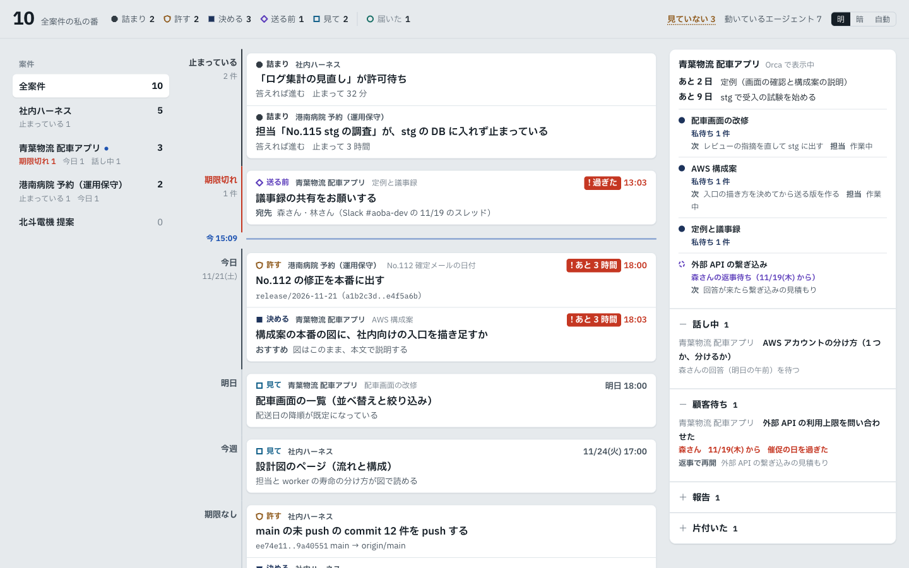

# 操縦席（cockpit）

10 本前後の案件を同時に動かすときに、自分が決める・許す・送る・見るものだけを、全案件まとめて期限順の 1 列に並べる画面です。案件ごとの窓口のエージェント（各ワークスペースのメイン）がカードを書き、人は窓でボタンを押して返します。迷うカードは「担当と話す」で、その仕事の担当のチャットへ渡します。

画面は 2 か所に出ます。

- **窓**: 左のディスプレイに置くブラウザのタブ（`http://127.0.0.1:47231`）。全案件を出す
- **パネル**: Orca の右のサイドバー。前面の案件 1 つだけを出す。Orca の下の帯にも前面の案件の「私の番 n」が出て、押すとパネルが開く



## 毎日の使い方

画面を開いたら、上の帯の数字で今の量をつかみ、1 列を上から片付けます。読むのは開いたカード 1 枚だけで、ほかのカードは 1 行の要約で何の件かが分かるようにしてあります。

| 場面 | 見るところ | 押すもの |
|---|---|---|
| 朝に全体を見る | 上の帯の「私の番 n」と種類ごとの内訳、左の案件の列の「止まっている」「期限切れ」「今日」 | 1 列の先頭から開く。「決める」はおすすめを選んだ状態で開くので、よければ「おすすめで決める」を 1 回押す。押すと次のカードが開く |
| Slack・Teams の連絡に返す | 「届いた」（送り主・原文・聞かれていること）と、担当が書いた「送る前」（宛先と本文） | 「送る前」は「コピーしてスレッドを開く」で貼って送り、「送った」を押す。返事が要らない連絡は「返事は要らない」 |
| worker の結果を見る | 「見て」（依頼の原文・見てほしい点・確かめた結果）と、先頭の「止まっている」 | 「開く」で成果物を見て「これでよい」。直したいときは「直してほしい（担当と話す）」 |
| 相談しながら資料を作る | 右の列の「話し中」 | 「担当と話す」を押すと、カードの書き出しがクリップボードに入り、開くチャットのタブの名前が知らせに出る。タブを開いて貼る |
| 夕方に片付ける | 右の列の「報告」「顧客待ち」「片付いた」 | 「報告」は「読んだ」か項目ごとの「戻して」。「顧客待ち」は催促の日を過ぎると朱になる |

操作してから 10 秒の間は「元に戻す」が残り、窓口が受け取るまで「受け取り待ち」と出ます。担当と話し始めたカードは「話し中」に移って件数から外れ、担当がカードを書き換えると「私の番」に戻ります。

## 画面の見方

- 上の帯: 全案件の私の番の合計と、詰まり・許す・決める・送る前・見ての内訳。「届いた」は件数に入れず、区切りの後ろに出す。「見ていない n」を押すと、操縦席の無い案件と、読めていない連絡の経路の一覧が開く
- 左の列: 案件ごとの私の番の数と、止まっている・期限切れ・今日・話し中の件数。押すとその案件だけに絞る
- 真ん中の 1 列: 止まっている → 期限切れ → 今の線 → 今日 → 明日 → 今週 → それより先 → 期限なし の順。今日と明日のカードは日付を省いて時刻だけを出す
- 右の列: 絞った案件（全案件のときは Orca で表示中の案件）の節目と仕事ごとの状態、話し中・顧客待ち・報告・片付いた
- 朱は期限まで 24 時間を切ったか、期限を過ぎたカードだけ。カードの種類は色と形の印で分ける

幅 760 未満では 1 列に並び、上の切り替えで「私の番」と「案件の今・待ち」を出し分けます。明・暗・自動の切り替えはブラウザに覚えさせ、既定は明るい地です。

## カード

| 種類 | いつ出るか | 押すもの | 件数 |
|---|---|---|---|
| 詰まり | 担当が質問・許可待ち・停止（Orca の状態からも作る） | 担当と話す・端末を開く | 数える |
| 許す | push・本番・データの変更の前。手作業（switch・承認・ログイン）を頼むときは `manual` | 許す・この案件では任せる・止める。`manual` があれば 済ませた・担当と話す | 数える |
| 決める | 設計・要件・費用・言い方が分かれる | おすすめで決める・選び直して決める・別の答え | 数える |
| 送る前 | 顧客か社内へ出す文面ができた | コピーしてスレッドを開く・送った・担当と直す・送らない | 数える |
| 見て | 任せた仕事の出来上がり | これでよい・直してほしいことを書く・直してほしい（担当と話す） | 数える |
| 届いた | 顧客の連絡が拾われた | 担当と話す・返事は要らない | 数えない |
| 話し中 | 担当と会話で作っている | 続きを話す | 数えない |
| 報告 | エージェントが決めた・済ませた | 戻して・読んだ | 数えない |

「決める」のカードは、何のため・なぜ今決めるか・選択肢・返事が無いとき・決めるための情報（これは何か・今どうなっているか・入れるならどうするか・得られること・失うこと）の順に並びます。選択肢を上に置くのは、おすすめと例で決められることが多く、迷ったときだけ下を読めば足りるためです。

「見て」の「直してほしいことを書く」は、書いた文を本文つきの `talk` の操作（`text` に原文）として記録します。カードは件数から外れて「直しを頼んだ（受け取り待ち）」、窓口が受け取ると「直し待ち」になり、担当が書き換えて `rev` を上げると私の番に戻ります。

手作業を頼む「許す」は `manual: { "where": "どこで", "command": "打つコマンド", "steps": ["手順"], "check": "済ませたあと窓口が確かめること" }` を書きます。カードの頭にどこで・打つコマンド（コピーのボタンつき）・手順を出し、「済ませた」は `sent` の操作で窓口に届きます。`command` も `steps` も無い `manual` は `checks.empty_manual` に出ます。

担当と話すは、担当が端末ならその端末、チャットならチャットのある worktree を前に出してタブの題を案内します（Orca にはチャットのタブを前に出す手段がありません）。`worker-start --agent` で立てたチャットの担当は、`owners` に受け取りの `terminal`（`structworker_…`）が書かれていても、`tasks[].worker` の Dispatch からチャットを引きます。端末が閉じた・チャットが閉じた・worktree が片付けられたときは何も開かず、理由を出してカードを話し中にしません。

カードの欄の形が違うとき（`evidence` を文字列で書くなど）は、その欄を出さずに表示し、どのカードのどの欄かを上の帯に出します。窓全体の描画は止めません。


## キーボード

| キー | 動き |
|---|---|
| `j`・`k` | 1 列の次・前のカードを開く |
| `1`〜`9` | 選択肢を選ぶ |
| `Enter` | 選んだ選択肢で決める（おすすめを選んだままの状態では決めない。続けて押して 2 枚決めてしまわないように） |
| `t` | 担当と話す |
| `u` | 最後の操作を元に戻す |
| `Esc` | カードを閉じる |

## 窓ではできないこと

- 担当のチャットのタブそのものを前に出すこと。Orca に既存のチャットを前に出す手段が無いので、チャットのあるワークスペースを前に出し、知らせにタブの名前を出す
- 「18 時まで本番も任せる」のような期限つきの任せ方。窓口が期限を持つ形が決まっていない
- 今日終わるはずの仕事が動いていないことの検知。終わる見込みをデータに持っていない

画面が満たす条件と、採らなかった案は [docs/user-stories.md](docs/user-stories.md) にあります。

## 仕組み

ここから下は、窓口のエージェントを作る人と、このプラグインを直す人向けです。

### 窓口とのやり取り


窓口が `.orca/cockpit.json` にカードを書き、窓とパネルが読んで出します。人の操作は `.orca/cockpit.user.json` に追記され、窓口には中身を送らず `【操縦席】未反映の操作があります` の 1 行だけを送ります。窓口は操作を読んで `cockpit.json` に反映し、反映し終えた操作の `op_id` を `applied_ops` に書きます。

カードの今の状態は、`cockpit.json` の `state` に操作ログを重ねて決めます（`src/model.ts` の `overlay`）。担当が書き換えてバージョン（`rev`）が上がると、古いバージョンへの操作は反映されず、カードはもう一度私の番に出ます。

### ファイルの形（バージョン 2）

型の全体は `src/model.ts`、全部の種類のカードを使った例は `fixtures/sample.ts` にあります。最小の例は次のとおりです。

```json
{
  "version": 2,
  "workspace": { "name": "問い合わせ管理システム", "milestones": [{ "date": "2026-11-24", "label": "定例" }] },
  "main": { "agent": "claude", "terminal": "term_abc" },
  "streams": [{ "id": "s1", "title": "一覧画面の改修" }],
  "tasks": [
    { "id": "t1", "stream": "s1", "phase": "実装", "title": "並べ替えと絞り込み", "state": "run",
      "worker": { "task_id": "task_123", "dispatch_id": "ctx_456" } }
  ],
  "owners": [{ "id": "o1", "title": "一覧画面の改修", "stream": "s1", "agent": "claude", "session": "sess_789" }],
  "cards": [
    { "id": "d1", "rev": 1, "kind": "decide", "state": "open", "stream": "s1",
      "title": "担当者の割り当て方を決める", "due": "2026-11-22T18:00:00+09:00",
      "purpose": "定例で画面の案を見せられる",
      "options": [
        { "id": "a", "label": "システムが自動で割り当てる", "recommended": true, "example": "30 件 → 5 人に 6 件ずつ" },
        { "id": "b", "label": "担当者が自分で取る" }
      ] }
  ],
  "applied_ops": []
}
```

| 欄 | 中身 |
|---|---|
| `streams` | 仕事（大タスク）。担当のチャットは仕事ごとに 1 つまで |
| `tasks` | 仕事の下の作業。`state` は `stop`・`run`・`wait`・`idle`・`ok`。`worker`（Orca の orchestration の Task と Dispatch の id）があれば、状態は Dispatch の様子から取る |
| `owners` | 仕事の担当（Orca のチャットか端末）。カードの「担当と話す」の相手。チャットは `session`（orcaSessionId）、端末は `terminal`（`term_…`）。担当の無い仕事のカードは窓口と話す |
| `routes` | 連絡を拾う経路（Slack・Teams・メール）と、見張りが読んだ時刻。古いと「見ていない」に出る |
| `cards` | 人に返してほしいもの。`kind` は上のカードの 8 種類（`stuck`・`permit`・`decide`・`send`・`review`・`inbox`・`talk`・`report`） |
| `requests` | 人からの依頼の原文 |
| `applied_ops` | 窓口が反映し終えた操作の `op_id` |

人の操作は `.orca/cockpit.user.json` に `{ "ops": [{ "op_id": 1, "at": "…", "item_id": "d1", "item_rev": 1, "type": "decide", "option_id": "a" }] }` の形で追記されます。窓と同じ判定済みの状態は `node window/state.ts <ワークスペースの root>` で JSON として読めます。hook と窓口はこの出力の `overview`・`mine`・`jobs`・`checks` を読みます。

### 構成

| ファイル | 役割 |
|---|---|
| `src/model.ts` | ファイルの形（バージョン 2）と、cockpit.json に操作ログを重ねる処理 |
| `src/migrate.ts` | バージョン 1（`items`）からバージョン 2（`cards`）への移し替え |
| `src/state.ts` | 期限の区切り・私の番の 1 列・案件の今・話す相手・Orca のサイドバーの状態をまとめて決める。画面と `window/state.ts` はここを通す |
| `src/store.ts` | `.orca/` のファイルを読む・操作を追記する（バージョンと選択肢を確かめる）・窓口に合図を送る。パネルの worker と窓の常駐プロセスが共有する |
| `src/view.ts` | 表示の状態から HTML を作る（DOM に触らない） |
| `src/style.ts` | CSS（明暗のトークン、container query で 1440・760 未満・520 未満を切り替える） |
| `src/controller.ts` | クリックやキーボード入力を操作につなぐ。パネルと窓のページが共有する |
| `src/worker.ts` | パネルの worker。前面のワークスペースのファイルを見張ってパネルに送り、下の帯を更新し、前面が変わるたびに `focus.json` を書く |
| `src/panel.ts` | パネル（controller の送り先を worker にする） |
| `window/server.ts` | 窓の常駐プロセス（launchd） |
| `window/page.ts` | 窓のページ（controller の送り先を常駐プロセスにする） |
| `window/migrate.ts` | 移し替えのコマンド |
| `window/state.ts` | 判定済みの状態を JSON で出すコマンド |
| `window/orca-state.ts` | `orca worktree ps`・`terminal list`・`orchestration worker-show` からメイン・worker・worktree を決める |
| `fixtures/sample.ts`・`fixtures/demo.ts` | 架空の 4 案件の見本と、偽の Orca で窓を手元で動かす道具 |

<details>
<summary>移し替え（バージョン 1 → バージョン 2）</summary>

```sh
node window/migrate.ts <ワークスペースの root>          # 移した結果を出すだけ
node window/migrate.ts <ワークスペースの root> --write  # 書き換える
```

- 未反映の操作が残っていれば書かずに断る。先に窓口に反映させる
- 元のファイルは `cockpit.v1.json`・`cockpit.archive.v1.json` に残す
- `dec` は中身で分ける（`topic: push` は「許す」、`draft` があれば「送る前」、ほかは「決める」）。`ask` は「送る前」、`rev` は「見て」、`ack` は「報告」。どのカードも `rev` を 1 つ上げるので、古いバージョンへの操作は通らない
- `tasks[].worker` は orchestration の形（`{ task_id, dispatch_id }`）だけを写す。workerctl の頃の形（`{ worktree_id, terminal }`）は指す先が無いので外し、済んでいないタスクの id を結果に出す（続けるなら立て直して書く）
- `summary`・`cockpit.talk.json` は移さない（依頼の `deliverables` は残す）。窓はバージョン 1 のファイルを読まず、移し替えのコマンドを添えて断る

</details>

<details>
<summary>Orca のサイドバーとそろえる</summary>

窓のカードと Orca のサイドバーで、同じ仕事が同じ名前・同じ状態で出るようにします。`node window/state.ts <root>` の `jobs[].orca` に、仕事ごとの表示名（20 字まで）・状態・未読の印が出るので、窓口はそれに合わせて `orca worktree set --display-name / --workspace-status / --unread` を打ちます。

| 案件の今 | Orca の状態 |
|---|---|
| 私待ち | `in-review`（未読の印を付ける） |
| 止まっている・作業中・顧客待ち | `in-progress` |
| 未着手 | `todo` |
| 済 | `completed`（取り込んだら消す） |

端末とチャットの題は `<短い題>（worker）`・`<短い題>（担当）`、窓口は `窓口（<案件の役割>）` です。「担当と話す」の知らせは、この題でタブを案内します。20 字を超える名前は `checks.long_names` に出ます。

</details>

<details>
<summary>窓の常駐プロセスと Orca の状態</summary>

```
Orca ──workspace.changed / agent.status.changed──▶ パネルの worker
                                                     │ focus.json（前面のパス・メインの端末・エージェントの変化の時刻）
                                                     ▼  ~/Library/Application Support/cockpit/
   各ワークスペースの .orca/ ──fs.watch──▶ 常駐のプロセス（127.0.0.1:47231）──SSE──▶ 窓のページ
                                          │  orca worktree ps / terminal list / agent list / orchestration worker-show
                                          └─ 操作の追記・orca terminal send / switch / worktree activate / file open
```

- 起動は launchd などの常駐の仕組みに任せる。ブラウザ向けの TS は、配るときに Node の `module.stripTypeScriptTypes` で型を除く。ビルドの手順は無い。配るのは `window/server.ts` の `SERVED` に書いたファイルだけ
- 操縦席の無い本線と、読めていない連絡の経路（`routes`）は「見ていない」として数を出す。見ていないものがあるときは「何もしなくてよい」と出さない
- worker の記録: 窓口が担当や worker を Orca の orchestration で立てたら、タスクの `worker` に受け取った `task_id`・`dispatch_id` を書く。窓は済んでいないタスクの Dispatch を `orca orchestration worker-show --dispatch <id> --full` で引き、Dispatch の端末で worker とタスクを結ぶ。worker_done を返したら取り込み待ち、起動できない・落ちた・人の確認待ちは詰まり、Orca に無ければ「Orca に見つからない」の詰まりになる
- Orca の監視外で止まったもの（`bin/stallwatch` が書く `alerts.json`）は、窓の上にエラーの行で出す
- 前面のワークスペースは、パネルの worker が書く `focus.json` を見張って取る（ポーリングしない）
- Orca を呼ぶのは窓が表示されている間だけで、(1) 接続したとき、(2) `focus.json` にあるエージェントの変化時刻が変わったとき（5 秒に 1 回まで）、(3) 60 秒ごと
- 止まった worker は詰まりのカードになる。題は「「仕事の名前」が許可待ち」の形で、窓口が書いた詰まりと同じ仕事（タスクか担当の端末）なら重ねて出さない。許可待ち・返事待ちは「答えれば進む」、落ちた・ログイン切れは「私では直せない」と分ける

メモリ（2026-11-16 に測った値）: 常駐プロセスは窓 1 枚が接続して 60 秒ごとに確かめている状態で物理フットプリント 51〜61 MB（RSS 75〜95 MB）、窓 1 枚（Chrome のアプリ表示）で増える renderer は 35 MB。常駐プロセスのメモリの大半は、Node が `.ts` を読むときに読み込まれる型除去の WebAssembly です。

</details>

<details>
<summary>窓口の端末への合図</summary>

端末には中身を送らず、`【操縦席】未反映の操作があります` の 1 行だけを送ります。「担当と話す」「別の答え」「直してほしい」（見ての直しの指示）は、合図の 1 行にカードの id と本文の頭を載せます。

- 取り消しの猶予（10 秒）が過ぎ、窓口が入力待ちのときに自動で送る（作業中に送ると入力欄に混ざるため）
- パネルと窓は別のプロセスなので、操作を書いたほうが 10 秒で送り、もう片方は 30 秒待ってから拾う。どこまで送ったかは `~/Library/Application Support/cockpit/notified.json` で共有する
- 窓口が Orca のチャットで `main.terminal` が空のときは送る手段が無いので、「次に話しかけたときに反映されます」と出す

</details>

<details>
<summary>前にも言った・引き継ぎ</summary>

- 案件 1 つを出しているとき（パネル・絞り込み）は、上の帯に「前にも言った」がある。押すと、カードを持たない `repeat`（`item_id` は空）を追記する。前に伝えたことを窓口が落としたという合図で、窓口の hook が押した回数を数え、新しいチャットへの引き継ぎに使う
- hook が引き継いだときに書く `.orca/cockpit/handoff.json`（`at`・`reason`）を読み、1 日だけ「窓口を新しいチャットに引き継ぎました」と出す

</details>

<details>
<summary>成果物と資料を開く</summary>

`href`・`links` は種類の印（Drive・PR・Slack・ページ・ファイル）を付けたボタンで出します。

- http(s) の URL: 窓は常駐プロセスが macOS の `open` で既定のブラウザに渡す（http と https 以外は断る）。パネルは Orca の `shell.openExternal` で開く
- ファイル: ワークスペースからの相対パスと、本線の子 worktree 内にある絶対パスだけを開く。`path:行` は窓では `orca file open --line` でその行を開く
- 一時フォルダ（`/tmp`・`/private/tmp`・`/var/folders`）のファイルを指す「見て」「報告」のカードは、`window/state.ts` の `checks.local_deliverables` に出る。窓口は artifact にして URL で渡し直す

</details>

<details>
<summary>セキュリティ</summary>

- 待ち受けは 127.0.0.1 だけ。Host が `127.0.0.1:<port>`・`localhost:<port>` 以外の要求は断る（DNS rebinding）
- 書き込みと送信（`/api/*`）は、起動のたびに作るトークン（配るページにだけ埋める）と Origin の両方が合うものだけ受ける。SSE もトークンが要る
- 読むファイルは `.orca/` の中だけで、`..` とシンボリックリンクで外へ出るものは読まない（`src/store.ts` の `readInOrca`）。開くファイルもワークスペースの中だけ
- figure の SVG は、パネルと同じように script・外部参照・イベント属性を取り除いてから描く

</details>

### 書体

IBM Plex Sans JP（Mac に入れておく）を第一に、無ければヒラギノを使います。パネルは Orca のサンドボックスで Web フォントを読めないので、Mac に入れた書体を名前で指定します。

### 開発

```sh
orca plugin test .          # model・migrate・state・view・worker と、窓の常駐のプロセスのテスト
orca plugin check . && orca plugin validate .
COCKPIT_PORT=47299 node --disable-warning=ExperimentalWarning fixtures/demo.ts $TMPDIR/ckdemo   # 架空の 4 案件で窓を手元で動かす
node window/state.ts <ワークスペースの root>   # hook と窓口が読む判定済みの状態
```

- `orca plugin dev load .` は本物の `local.cockpit` を置き換える。worktree で触るときは、上のテストと別のポートの窓で確かめ、読み込んだら報告の前に `orca plugin dev unload <dir>` で外す
- `local.cockpit` が承認待ち・止まっている・開発用に置き換わっているときは、窓の上の帯に理由を出す（`window/orca-state.ts` の `pluginProblem`）
- HTML パネルは `orca plugin shot --act` で操作できないので、操作の流れは窓のページ（同じ controller）をブラウザで確かめる
- worker と窓の常駐プロセスのテストは `fs.watch` を使う。ファイルの見張りを止める sandbox の中では EMFILE で落ちるので、sandbox の外で回す
